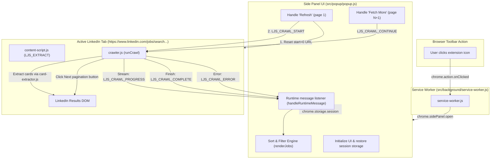
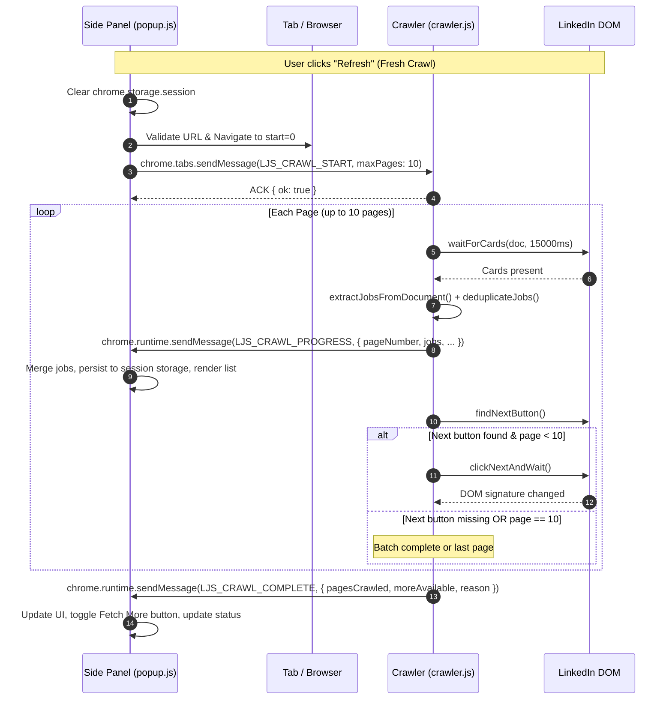

# Architecture: LinkedIn Job Sorter

This document describes the implemented architecture, data flow, component interactions, and state management of the **LinkedIn Job Sorter** Chrome extension (Manifest V3).

---

## 1. System Overview

LinkedIn Job Sorter surfaces the freshest job opportunities by extracting job postings directly from LinkedIn search result feeds, converting human-readable relative posting labels (e.g., *"Posted 15 minutes ago"*, *"3 hours ago"*) into numeric minutes, sorting them chronologically (newest first), and presenting them in a dedicated Chrome Side Panel.

### Core Architectural Principles

1. **Client-Side & Local Only**: All parsing, sorting, filtering, and crawling run entirely within the user's browser. No data is sent to external servers or remote telemetry services.
2. **No Bundlers / Plain Scripts with UMD**: The extension avoids heavy compilation toolchains (Webpack, Vite, Rollup). Pure JavaScript library modules use a Universal Module Definition (UMD) shim allowing them to run natively in browser contexts (attaching to `globalThis.LJS`) and in Node.js test environments (via `require()`).
3. **Safe DOM Manipulation**: The extension prohibits `innerHTML` across all UI rendering. All elements are constructed using `document.createElement`, `textContent`, and explicit DOM attributes to eliminate Cross-Site Scripting (XSS) risks.
4. **Persistent Side Panel UI**: The user interface runs in Chrome's Side Panel (`chrome.sidePanel`), docking alongside the active LinkedIn tab without closing when the user switches tabs or interacts with page content.
5. **Session-Bound Persistence**: Extracted listings and pagination state are stored in `chrome.storage.session`. Jobs persist across side-panel open/close events within a browser session, but are cleared when clicking "Refresh" or closing the browser.

---

## 2. Directory and Module Organization

```text
linkedin-job-sorter/
├── manifest.json                  # Manifest V3 extension configuration
├── package.json                   # Project metadata, engine requirements, test script
├── package-lock.json              # Pinned development dependencies (jsdom)
├── assets/
│   └── icons/                     # Extension branding icons (16, 32, 48, 128 px)
├── src/
│   ├── background/
│   │   └── service-worker.js      # Background worker; opens and configures side panel
│   ├── content/
│   │   ├── content-script.js      # Single-page extraction listener (LJS_EXTRACT)
│   │   └── crawler.js             # Multi-page crawler; automates pagination & streaming
│   ├── lib/                       # Pure logic and parsing modules (UMD)
│   │   ├── card-extractor.js      # DOM scraper extracting structured job cards
│   │   ├── posted-time-parser.js  # Relative time string parser -> minutes
│   │   ├── search-context.js      # URL validator and query-parameter parser
│   │   ├── deduplicate-jobs.js    # Job deduplication and field-merging engine
│   │   ├── job-sorter.js          # Sorting engine (newest, oldest, original)
│   │   └── job-filter.js          # Filtering engine (text, hide-viewed, hide-applied, etc.)
│   ├── popup/
│   │   ├── popup.html             # Side panel HTML shell
│   │   ├── popup.css              # Stylesheet (dark-mode, badge colors, sticky header)
│   │   └── popup.js               # Side panel UI controller and event coordinator
│   └── shared/
│       └── messages.js            # Shared message types and error code constants (UMD)
├── tests/
│   ├── fixtures/
│   │   ├── card-a.html            # Static HTML card with posting time
│   │   ├── card-b.html            # Static HTML card with "Viewed" label (missing time)
│   │   └── multi-cards.html       # Multi-card fixture for integration tests
│   ├── card-extractor.test.js     # DOM extraction assertions against real markup fixtures
│   ├── crawler-dom.test.js        # Next-button detection & loader-detection unit tests
│   ├── deduplicate-jobs.test.js   # Deduplication & field-merging unit tests
│   ├── job-filter.test.js         # Filtering logic unit tests
│   ├── job-sorter.test.js         # Sorting modes and tie-breaker unit tests
│   ├── posted-time-parser.test.js # Regex parsing & unit multiplier test suite
│   └── search-context.test.js     # Search context & URL validation unit tests
└── docs/
    ├── ARCHITECTURE.md            # Architecture, data flow, and technical specifications
    ├── DEVELOPMENT.md             # Developer guide, debugging, testing, release packaging
    ├── PRIVACY.md                 # Data handling, storage lifecycle, permission rationale
    ├── CHANGELOG.md               # Version history and release notes
    └── CONTRIBUTING.md            # Contribution rules, coding standards, PR workflow
```

---

## 3. Component Architecture and Interaction

The system comprises four decoupled execution layers:



### Component Responsibilities

| Component | Execution Context | Key Responsibilities |
|---|---|---|
| **`service-worker.js`** | Background Service Worker | Configures `chrome.sidePanel` options for the active tab and opens the panel upon `chrome.action.onClicked`. Logs install/update lifecycle events. |
| **`popup.js` / `popup.html`** | Chrome Side Panel | Manages user interactions (Refresh, Fetch More, filtering, search query input). Persists and restores state via `chrome.storage.session`. Controls crawl batches and coordinates tab updates. Formats and renders job cards. |
| **`crawler.js`** | Injected Tab Content Script | Coordinates multi-page crawling loop. Detects and clicks LinkedIn's pagination Next button. Waits for DOM transitions and checks active loader indicators (`isLoadingStateActive`). Streams progress messages to the side panel. |
| **`content-script.js`** | Injected Tab Content Script | Handles single-page extraction requests (`LJS_EXTRACT`). Synchronously parses visible DOM cards and returns extraction stats. |
| **`card-extractor.js`** | Shared Library (`lib`) | Pure DOM parser. Scrapes job titles, companies, locations, workplace types, badges (`Easy Apply`, `Viewed`, `Applied`, `Early applicant`), and links from LinkedIn DOM card elements. |
| **`posted-time-parser.js`**| Shared Library (`lib`) | Regex parser converting English relative time strings (`"Posted 2 hours ago"`, `"just now"`, `"Reposted 1 day ago"`) into integer minutes. |
| **`search-context.js`** | Shared Library (`lib`) | Extracts search parameters (`keywords`, `location`, `f_TPR`). Validates search URL requirements (must be under `/jobs/search` with `f_TPR=r86400`). |
| **`deduplicate-jobs.js`** | Shared Library (`lib`) | Merges duplicate job records by ID or canonical URL, preserving earlier records while filling missing metadata from subsequent instances. |
| **`job-sorter.js`** | Shared Library (`lib`) | Sorts job arrays by `ageMinutes` ascending (newest), descending (oldest), or DOM index (original order), keeping unknown ages at the bottom. |
| **`job-filter.js`** | Shared Library (`lib`) | Filters job lists by text query, `easyApplyOnly`, `hideViewed`, and `hideApplied`. |
| **`messages.js`** | Shared Library (`shared`) | Central source of truth for message action types (`LJS_CRAWL_START`, `LJS_CRAWL_PROGRESS`, etc.) and system error codes. |

---

## 4. Message Protocol and Flow

All communication between the Side Panel and Content Scripts uses Chrome's runtime messaging (`chrome.tabs.sendMessage` and `chrome.runtime.sendMessage`):



### Message Types Reference (`src/shared/messages.js`)

| Constant | Identifier | Direction | Purpose |
|---|---|---|---|
| `MSG_EXTRACT` | `'LJS_EXTRACT'` | Side Panel → Content Script | Requests immediate single-page card extraction. |
| `MSG_CRAWL_START` | `'LJS_CRAWL_START'` | Side Panel → Crawler | Instructs crawler to begin crawling from page 1 (`maxPages: 10`). |
| `MSG_CRAWL_CONTINUE` | `'LJS_CRAWL_CONTINUE'` | Side Panel → Crawler | Instructs crawler to continue crawling from current page (`advanceFirst: true`). |
| `MSG_CRAWL_STOP` | `'LJS_CRAWL_STOP'` | Side Panel → Crawler | Halts an ongoing crawl loop. |
| `MSG_CRAWL_PROGRESS` | `'LJS_CRAWL_PROGRESS'` | Crawler → Side Panel | Streams extracted jobs, page number, and stats for each completed page. |
| `MSG_CRAWL_COMPLETE` | `'LJS_CRAWL_COMPLETE'` | Crawler → Side Panel | Notifies that the batch has ended (`moreAvailable: boolean`, `reason: string`). |
| `MSG_CRAWL_ERROR` | `'LJS_CRAWL_ERROR'` | Crawler → Side Panel | Reports a terminal crawl error with an error code and description. |

---

## 5. Job Discovery and Extraction Algorithm

Card extraction is implemented in [`src/lib/card-extractor.js`](file:///home/rajendra-vaddi/Documents/Projects/linkedin-job-sorter/src/lib/card-extractor.js) via `extractJobsFromDocument(doc, now)`.

### 5.1 Card Root Discovery
LinkedIn's feed repeats custom attributes and container structures:
1. Primary selector: `doc.querySelectorAll("[componentkey^='job-card-component-ref-']")`.
2. Outermost guard: LinkedIn nests duplicate `componentkey` tags inside the card root. The parser drops any card element whose ancestor already matches `[componentkey^='job-card-component-ref-']`.
3. Fallbacks for legacy/alternative layouts: `[data-occludable-job-id]`, `[data-job-id]`, `[data-entity-urn*='urn:li:jobPosting:']`, or containers around `a[href*='/jobs/view/']`.

### 5.2 The Screen-Reader "Twin Text" Pattern
LinkedIn uses an accessibility pattern where a single paragraph contains both a screen-reader span and a visible visual span:
```html
<p>
  <span class="sr">Software Applications (Verified job)</span>
  <span aria-hidden="true">Software Applications <span><svg id="verified-small"></svg></span></span>
</p>
```
Using `p.textContent` directly concatenates both spans, causing duplicated text (*"Software ApplicationsSoftware Applications"*). The function `readTwinText(p)` separates them:
- `sr`: Text of the first direct child `span` without `aria-hidden='true'`.
- `visible`: Text of the first child `span[aria-hidden='true']` cloned and stripped of child element nodes (removing SVGs and badge labels).

### 5.3 Paragraph Classification Pipeline
Each card's paragraphs (`<p>`) are scanned sequentially and categorized:
- **Separator**: Contains only `·` or whitespace -> skipped.
- **Posting Label**: Starts with `"Posted"` or `"Reposted"`, or matches `parsePostedLabel` -> saved as `postingParagraph`.
- **Viewed Indicator**: Matches `/^viewed$/i` -> sets `viewed = true`. (Note: LinkedIn replaces the posting label with *"Viewed"* once a job is clicked).
- **Applied Indicator**: Matches `/^applied(\s|$)/i` -> sets `applied = true`.
- **Early Applicant**: Matches `/^be an early applicant$/i` -> sets `earlyApplicant = true`.
- **Easy Apply**: Matches `/^easy apply$/i` -> sets `easyApply = true`.
- **Promoted**: Matches `/^promoted$/i` -> sets `promoted = true`.
- **Content Candidates**: Remaining paragraphs in positional order:
  1. Index 0: **Job Title** (cleaned of any dismiss labels; fallback to dismiss button `aria-label`).
  2. Index 1: **Company Name**.
  3. Index 2: **Location and Workplace Type** (regex `/^(.*)\s*\((On-site|Remote|Hybrid)\)$/i` separates location from workplace type).

### 5.4 URL Reconstruction
Real LinkedIn search result cards frequently lack standard `<a href="...">` anchor tags on the title, acting as JavaScript-controlled `div[role="button"]` containers.
- If an anchor tag matching `/jobs/view/(\d+)` exists within the card, it is used (`urlSource: 'anchor'`).
- Otherwise, the URL is deterministically synthesized from the extracted numeric job ID:
  `https://www.linkedin.com/jobs/view/<id>/` (`urlSource: 'built-from-id'`).
- All URLs are validated against `^https:\/\/www\.linkedin\.com\/jobs\/view\/\d+\/?$` before being rendered or navigated.

---

## 6. Posting-Time Parsing Engine

The parsing logic in [`src/lib/posted-time-parser.js`](file:///home/rajendra-vaddi/Documents/Projects/linkedin-job-sorter/src/lib/posted-time-parser.js) parses English relative timestamps into integer minutes:

### 6.1 Regular Expression
```javascript
const POSTED_RE = /^(?:(posted|reposted)\s+)?(?:(\d+|an?)\s*(min|mins|minute|minutes|hr|hrs|hour|hours|day|days|week|weeks)\s+ago|just now)$/i;
```

### 6.2 Unit Multipliers
- `min`, `mins`, `minute`, `minutes` -> $1$
- `hr`, `hrs`, `hour`, `hours` -> $60$
- `day`, `days` -> $1440$ ($24 \times 60$)
- `week`, `weeks` -> $10080$ ($7 \times 24 \times 60$)
- `"just now"` -> $0$ minutes (`precision: 'low'`)
- `"a"` or `"an"` -> quantity treated as $1$

### 6.3 Parsing Statuses
- `'parsed'`: Exact match against supported relative intervals.
- `'unrecognized'`: Strings containing `"Posted"`, `"Reposted"`, or ending in `"ago"` that do not match the regular expression (e.g., *"Posted 1 month ago"*, non-English locales). Assigned `ageMinutes: null`.
- `'not-a-label'`: General text that is not a posting string (e.g., *"25 applicants"*, *"Actively reviewing"*).

---

## 7. Deduplication, Sorting, and Filtering

### 7.1 Deduplication (`src/lib/deduplicate-jobs.js`)
When crawling across multiple pages, LinkedIn's live feed frequently duplicates listings across page boundaries.
- **Key Selection**: Primary key is `job.id`. If absent, fallback key is canonicalized `job.url` (host and path lowercased, trailing slash stripped).
- **Collision Resolution**: The record with the lower `originalIndex` (first encountered) is retained.
- **Metadata Merging (`mergeInto`)**:
  - Missing scalar fields (`company`, `location`, `title`, etc.) in the earlier record are backfilled from the later duplicate.
  - Boolean flags (`easyApply`, `viewed`, `applied`, `earlyApplicant`, `reposted`) merge with logical OR (`true` takes precedence over `null`).
  - `ageMinutes`: A known age is **never** overwritten by `null`. If both are known and differ, the earlier record's age is preserved.

### 7.2 Sorting (`src/lib/job-sorter.js`)
- Modes supported: `'newest'` (default), `'oldest'`, and `'original'`.
- In `'newest'` mode, known `ageMinutes` sort ascending (smaller number = more recent).
- In `'oldest'` mode, known `ageMinutes` sort descending (larger number = older).
- **Unknown Ages**: Records where `ageMinutes === null` (viewed jobs, applied jobs, unrecognized formats) are placed at the bottom in both `'newest'` and `'oldest'` modes.
- **Tie-Breaking**: Equal ages are tie-broken by `originalIndex` to preserve original listing stability.

### 7.3 Filtering (`src/lib/job-filter.js`)
- **Query**: Case-insensitive substring match against `job.title` OR `job.company`.
- **Hide Viewed**: Excludes cards where `job.viewed === true`.
- **Hide Applied**: Excludes cards where `job.applied === true`.
- **Easy Apply Only**: Retains only cards where `job.easyApply === true`.

---

## 8. Multi-Page Crawling Lifecycle

The crawling loop in [`src/content/crawler.js`](file:///home/rajendra-vaddi/Documents/Projects/linkedin-job-sorter/src/content/crawler.js) operates as an asynchronous state machine:

### 8.1 Constraints & Enforcement
1. **Target Page Validation**: Must be on `https://www.linkedin.com/jobs/search...`.
2. **"Past 24 hours" Enforcement**: The URL must contain the query parameter `f_TPR=r86400`. If missing or set to another interval (e.g., past week `r604800` or past month `r2592000`), the extension rejects crawling with error code `FILTER_REQUIRED`.
3. **Safety Page Limit**: Crawls run in batches of up to **10 pages** (~250 jobs) per execution to avoid throttling or runaway memory consumption.

### 8.2 Pagination Mechanism
- **Next Button Locator**:
  - Primary selector: `button[data-testid="pagination-controls-next-button-visible"]`.
  - Termination check: If LinkedIn renders non-visible or disabled pagination buttons (`button[data-testid*="pagination-controls-next"]` without `-visible`, or buttons containing `artdeco-button--disabled`), the crawler concludes the last page has been reached.
- **Page Change Verification (`clickNextAndWait`)**:
  - Computes a DOM card signature (`getCardsSignature`) combining the first 3 job card IDs/keys.
  - Clicks the Next button.
  - Polls every 250ms for a change in card signature or URL (`start=25`, `start=50`, etc.).
  - Settle delay: Adds a 500ms delay after DOM change to allow sub-elements to finish rendering.

### 8.3 Network Latency and Timeout Handling
On slow connections or API rate-limiting, LinkedIn's AJAX response can take over 10 seconds:
- **Active Loader Detection (`isLoadingStateActive`)**:
  Inspects the DOM for `.artdeco-loader`, `.jobs-search-results-list--loading`, `[data-view-name*="loading"]`, or `.ghost-job-card`.
- **Dynamic Timeout Extension**:
  - `waitForCards`: Default timeout 15s; extends to 25s if a loader is detected.
  - `clickNextAndWait`: Default timeout 16s; extends to 25s if a loader is detected.
- **Network Timeout vs. End-of-Pages Distinction**:
  If a page transition times out, the crawler checks if the Next button is still in the DOM:
  - If the Next button is still present, it sends `MSG_CRAWL_COMPLETE` with `moreAvailable: true` and `reason: 'NETWORK_TIMEOUT'`.
  - The side panel UI retains all collected jobs, preserves `moreAvailable = true`, displays a clear status message, and shows the **"Fetch More"** button so the user can resume.

---

## 9. State Management and Persistence

```text
chrome.storage.session
├── ljs_jobs: Array<JobRecord>
└── ljs_crawl_state: {
      pagesCompleted: number,
      moreAvailable: boolean,
      lastCrawledAt: string (ISO timestamp),
      searchContext: {
        keywords: string | null,
        location: string | null,
        dateFilterLabel: string | null
      }
    }
```

- **Persistence Scope**: Data is stored using `chrome.storage.session`. This guarantees data persists if the user toggles the side panel or changes browser focus, but automatically clears when the browser is closed.
- **Explicit Reset ("Refresh")**: Clicking "Refresh" clears `ljs_jobs` and `ljs_crawl_state` from storage, resets in-memory variables, updates the tab URL to `start=0`, and launches a fresh 10-page crawl.
- **Batch Continuation ("Fetch More")**: Clicking "Fetch More" increments the batch counter (`startPageNumber = pagesCompleted + 1`), keeps existing jobs, and invokes `LJS_CRAWL_CONTINUE` with `advanceFirst: true`.

---

## 10. Chrome APIs, Permissions, and Security

### Manifest Permissions (`manifest.json`)

| Permission | Purpose | Principle of Least Privilege Justification |
|---|---|---|
| `sidePanel` | Host extension UI in Chrome's native side pane. | Keeps the UI docked alongside LinkedIn search results without auto-closing on focus loss. |
| `scripting` | Programmatically inject content scripts (`chrome.scripting.executeScript`). | Injects extraction scripts if the extension was reloaded or installed while a tab was already open. |
| `tabs` | Query active tab URL, reload page 1, and update active listing. | Required to read LinkedIn search query parameters and navigate results to `start=0`. |
| `storage` | Access `chrome.storage.session`. | Persists crawl results across side panel open/close events within a session. |
| Host: `https://www.linkedin.com/*` | Restricts content script injection and tab operations. | Strictly isolates extension operation to LinkedIn domains only. |

### Security Measures
- **Content Security**: No remote scripts, CDN links, or `eval()` calls are used.
- **XSS Prevention**: Zero use of `innerHTML`. All DOM rendering in `popup.js` uses `document.createElement`, `textContent`, and `classList`.
- **Safe Link Handling**: Job links open with `target="_blank"` and `rel="noopener noreferrer"`. URLs are validated against a strict regex before assignment to `href`.
- **In-Tab Selection**: Clicking "Open" on a search results page modifies `currentJobId` via `chrome.tabs.update`, selecting the job in LinkedIn's split view without reloading or navigating to a new tab.

---

## 11. Known Architectural Limitations

1. **DOM Class Names Are Ephemeral**: LinkedIn uses hashed, dynamically-generated CSS class names (e.g. `hv4lac`). The extension strictly avoids depending on class names for identification, using HTML semantics, ARIA attributes, and `data-testid` instead.
2. **DOM Virtualization**: LinkedIn may virtualize or unmount job cards that have scrolled far off screen. While the crawler iterates through pages 1 to 10 sequentially, within any single page it only captures currently rendered cards.
3. **English Relative Time Format Only**: The regex in `posted-time-parser.js` currently parses English phrases. Non-English interfaces (e.g., *"Il y a 3 heures"*) result in `timeStatus: 'unrecognized'` and `ageMinutes: null`.
4. **Viewed & Applied Jobs Conceal Posting Age**: LinkedIn replaces posting timestamps with *"Viewed"* or *"Applied"* once a user interacts with a job card. The extension marks these with explicit badges and places them after jobs with known posting times.
5. **Rate Limiting**: Aggressive crawling across dozens of pages within a short period may trigger LinkedIn rate limiting or bot detection. The 10-page batch limit and explicit delays mitigate this risk.

